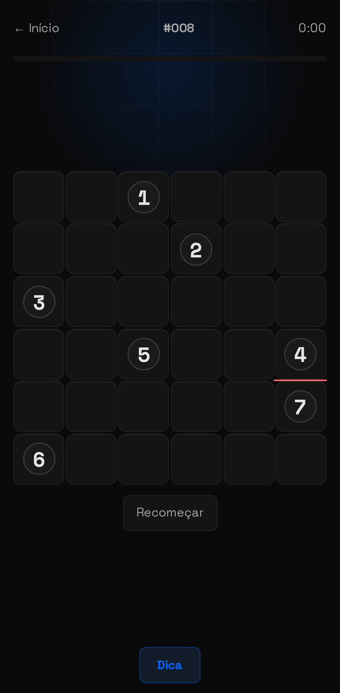
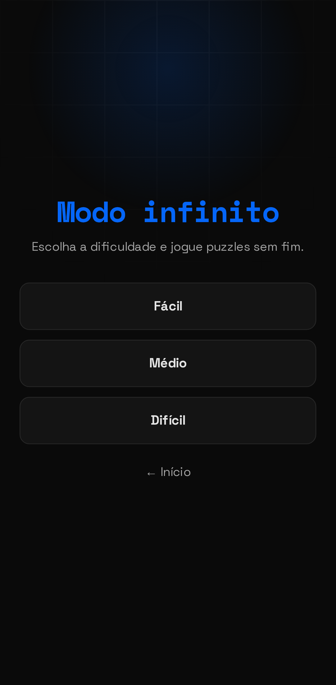
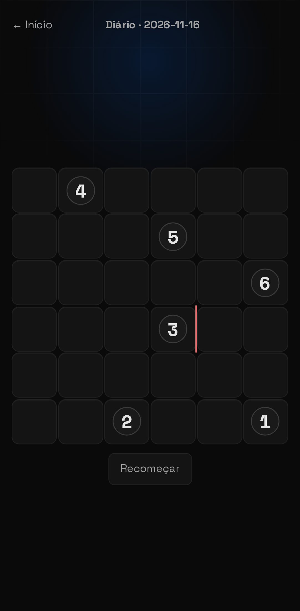

# Zip

Puzzle de caminho no estilo do Zip do LinkedIn. Você desenha uma linha contínua que passa por todas as células e visita os números em ordem, de 1 até N.

Os níveis são gerados por seed, então o nível 8 é o mesmo tabuleiro em qualquer aparelho. A progressão não acaba: o grid cresce de 4×4 até 7×7, e depois disso a dificuldade continua subindo com mais paredes e mais checkpoints.

| Nível | Modo infinito | Desafio diário | Sala multiplayer |
|---|---|---|---|
|  |  |  |  |

## modos

- **Níveis.** A progressão principal, com timer, estrelas e streak. Dica custa estrela. O progresso fica no `localStorage`.
- **Modo infinito.** Puzzles sem fim em Fácil, Médio ou Difícil. A dificuldade escolhida fixa o tamanho do grid e as paredes.
- **Desafio diário.** Um puzzle por dia UTC, o mesmo pra todo mundo, uma tentativa só. A seed vem da data, sem servidor.
- **Multiplayer 1v1.** O anfitrião escolhe dificuldade e formato da série, e os dois correm no mesmo puzzle. A conexão é WebRTC direto entre os navegadores (PeerJS), com link, QR code e código de 4 letras. Dá pra pedir revanche na mesma sala.

Níveis e desafio diário têm botão de compartilhar o resultado.

## rodar

```bash
bun install
bun run dev
```

O `dev` passa pelo portless. Pra testar multiplayer entre dois aparelhos na mesma rede, `bun run dev:lan` sobe um servidor PeerJS local na porta 9000 junto com o vite.

## verificar

```bash
bun run verify
```

Roda typecheck, biome, guard de determinismo, testes unitários (vitest), e2e (Playwright, Pixel 7) e o react-doctor. Os e2e do multiplayer usam um transport em memória (`VITE_TRANSPORT=broadcast`), então não precisam de rede.

## determinismo

Tudo em `src/game` é puro. Um guard (`bun run guard:determinism`) falha o build se aparecer `Math.random` ou `Date` ali, porque `generatePuzzle(n)` precisa dar o mesmo tabuleiro em todo dispositivo. Quem precisa do relógio, como o diário, recebe a data de fora.

## stack

React 19, Vite, Tailwind v4, react-router, PeerJS, TypeScript e Bun.
